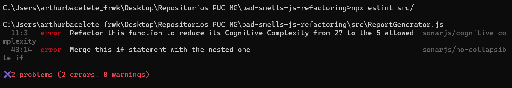
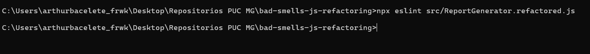
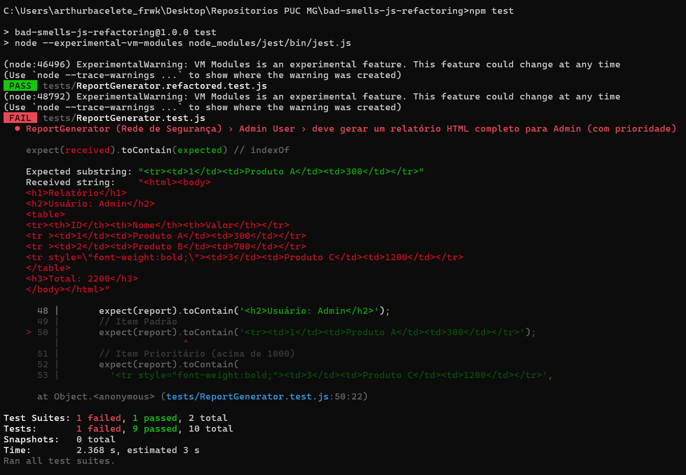

# Detecção de Bad Smells e Refatoração Segura

**Disciplina:** Teste de Software
**Trabalho:** Detecção de Bad Smells e Refatoração Segura
**Aluno:** Arthur Henrique Teixeira — **Matrícula:** 859123
**Repositório:** <https://github.com/bacelete/bad-smells-js-refactoring>

---

## 1. Análise de Smells

O código original (`src/ReportGenerator.js`) concentra toda a lógica em um único método, `generateReport`, com cerca de 55 linhas. Encontrei três smells principais.

### 1.1 Método Longo (Long Method)

`generateReport` monta o cabeçalho, filtra os itens por papel do usuário, decide quais itens são prioritários, formata cada linha em CSV ou HTML, soma o total e monta o rodapé. São pelo menos seis responsabilidades em um único método.

- **Manutenção:** para mudar qualquer detalhe (por exemplo, o layout do HTML) é preciso ler e entender o método inteiro, e qualquer mudança arrisca afetar as outras partes.
- **Testes:** não dá para testar uma regra isolada (por exemplo, "usuário comum só vê itens ≤ 500"). Todo teste precisa passar pelo método inteiro e verificar a string final.

### 1.2 Condicionais Complexas e Repetidas (Switch Statements / Complex Conditional)

O mesmo teste `if (reportType === 'CSV') … else if (reportType === 'HTML')` aparece **quatro vezes** (cabeçalho, corpo do ADMIN, corpo do USER e rodapé), e dentro do laço há ifs aninhados em até quatro níveis (`for` → `role` → `value` → `reportType`).

- **Manutenção:** adicionar um novo formato (por exemplo, JSON ou PDF) obriga a mexer em quatro lugares diferentes. Esquecer um deles gera um relatório quebrado sem erro de compilação. O mesmo acontece ao adicionar um novo papel (por exemplo, `MANAGER`).
- **Testes:** cada combinação de papel × formato × faixa de valor é um caminho diferente. O número de casos de teste necessários para cobrir todos os ramos cresce de forma multiplicativa.

### 1.3 Código Duplicado (Duplicated Code)

- A linha CSV `${item.id},${item.name},${item.value},${user.name}` é idêntica nos ramos ADMIN e USER.
- A linha HTML `<tr>…<td>${item.id}</td><td>${item.name}</td><td>${item.value}</td></tr>` aparece duas vezes, com uma pequena variação.
- `total += item.value` é repetido em **quatro** ramos.

- **Manutenção:** uma correção feita em uma cópia precisa ser lembrada em todas as outras. Foi exatamente o que aconteceu aqui: a linha HTML do ADMIN usa `` `<tr ${style}>` ``, que gera `<tr >` (com espaço) quando o item não é prioritário, enquanto a do USER gera `<tr>`. As duas cópias divergiram.
- **Testes:** os testes precisam verificar a mesma formatação em vários cenários, porque não há garantia de que as cópias se comportam igual.

### Smells secundários

- **Números mágicos:** `1000` (limite de prioridade) e `500` (limite de visibilidade do USER) aparecem sem nome.
- **Efeito colateral no parâmetro:** `item.priority = true` altera os objetos recebidos pelo método. Por isso os testes precisam fazer `JSON.parse(JSON.stringify(testItems))` para se proteger.
- **Campo não usado:** `this.db` é armazenado e nunca utilizado.

---

## 2. Relatório da Ferramenta (ESLint + eslint-plugin-sonarjs)

Configuração usada (`.eslintrc.json`): `eslint:recommended` + `plugin:sonarjs/recommended`, com `sonarjs/cognitive-complexity` limitado a **5**, além de `sonarjs/no-identical-functions` e `sonarjs/no-duplicated-branches` como erro. O limite de 5 já vinha no repositório e é mais rigoroso que o valor 15 sugerido no enunciado.



*Figura 1 — `npx eslint src/` antes da refatoração: 2 erros, complexidade cognitiva 27.*

**Como a ferramenta ajudou:** a análise manual identifica que o método "parece complicado", mas a regra `sonarjs/cognitive-complexity` **quantifica** isso. Ela soma +1 para cada `if`/`else if`/`for`/ternário e soma um peso adicional para cada nível de aninhamento. Assim, o `if (reportType === 'CSV')` no 4º nível de aninhamento custa bem mais que o do cabeçalho. Isso mostra que o problema principal não é a quantidade de ifs, e sim o **aninhamento**. Com esse número a refatoração ganha um critério objetivo (passar de 27 para ≤ 5) em vez de uma impressão subjetiva.

A ferramenta também apontou algo que eu não tinha anotado na análise manual: a regra `sonarjs/no-collapsible-if` (linha 43) indica que o `else if (user.role === 'USER')` contém um único `if (item.value <= 500)` aninhado, que poderia ser fundido em uma condição só. É um aninhamento desnecessário, fácil de passar despercebido na leitura. Além disso, a ferramenta é repetível e roda em CI, enquanto a revisão manual depende de quem lê.

---

## 3. Processo de Refatoração

O smell mais crítico era a **condicional complexa e repetida** dentro de um método longo, porque é ele que gera a alta complexidade cognitiva e a duplicação.

### Antes (trecho do corpo)

```js
for (const item of items) {
  if (user.role === 'ADMIN') {
    if (item.value > 1000) {
      item.priority = true;
    }
    if (reportType === 'CSV') {
      report += `${item.id},${item.name},${item.value},${user.name}\n`;
      total += item.value;
    } else if (reportType === 'HTML') {
      const style = item.priority ? 'style="font-weight:bold;"' : '';
      report += `<tr ${style}><td>${item.id}</td><td>${item.name}</td><td>${item.value}</td></tr>\n`;
      total += item.value;
    }
  } else if (user.role === 'USER') {
    if (item.value <= 500) {
      if (reportType === 'CSV') {
        report += `${item.id},${item.name},${item.value},${user.name}\n`;
        total += item.value;
      } else if (reportType === 'HTML') {
        report += `<tr><td>${item.id}</td><td>${item.name}</td><td>${item.value}</td></tr>\n`;
        total += item.value;
      }
    }
  }
}
```

### Depois

```js
const ROLE_RULES = {
  ADMIN: {
    canSee: () => true,
    isPriority: (item) => item.value > ADMIN_PRIORITY_THRESHOLD,
  },
  USER: {
    canSee: (item) => item.value <= USER_MAX_VISIBLE_VALUE,
    isPriority: () => false,
  },
};

const FORMATTERS = { CSV: new CsvFormatter(), HTML: new HtmlFormatter() };

generateReport(reportType, user, items) {
  const formatter = FORMATTERS[reportType];
  if (!formatter) {
    return '';
  }

  const rules = this.rulesFor(user);
  const visibleItems = items.filter((item) => rules.canSee(item));

  const body = visibleItems
    .map((item) => formatter.row(item, user, rules.isPriority(item)))
    .join('');

  const report =
    formatter.header(user) + body + formatter.footer(sumValues(visibleItems));

  return report.trim();
}
```

### Técnicas aplicadas

1. **Replace Conditional with Polymorphism:** as quatro cadeias `if (reportType === …)` viraram duas classes, `CsvFormatter` e `HtmlFormatter`, com a mesma interface (`header`, `row`, `footer`). O método escolhe o formatador uma única vez com `FORMATTERS[reportType]`. Para adicionar um formato novo basta criar uma classe, sem mexer em `generateReport` (princípio Aberto/Fechado).
2. **Replace Conditional with Polymorphism / Decompose Conditional (papéis):** a cadeia `if (user.role === …)` virou o mapa `ROLE_RULES`, em que cada papel declara `canSee` e `isPriority`. Um papel desconhecido usa `NO_ACCESS_RULES`, o mesmo comportamento do original (nenhum item listado).
3. **Extract Method / Extract Function:** `sumValues` e `rulesFor` isolam o cálculo do total e a escolha da regra. O total é calculado uma vez sobre `visibleItems`, o que elimina as quatro cópias de `total += item.value`.
4. **Replace Magic Number with Symbolic Constant:** `ADMIN_PRIORITY_THRESHOLD = 1000` e `USER_MAX_VISIBLE_VALUE = 500`.
5. **Remoção de efeito colateral (Separate Query from Modifier):** a prioridade é calculada por `isPriority(item)` em vez de gravar `item.priority = true` no objeto do chamador.

Com isso, `generateReport` passa de um único bloco com 4 níveis de aninhamento para um fluxo linear com um único `if` (guard clause), e cada função fica abaixo do limite de complexidade cognitiva 5.



*Figura 2 — `npx eslint src/ReportGenerator.refactored.js`: nenhum problema reportado.*



*Figura 3 — `npm test`: a suíte do arquivo refatorado passa (PASS); a do original falha em 1 teste, pelo bug do `<tr >` explicado abaixo. Os avisos `ExperimentalWarning` vêm do flag `--experimental-vm-modules` e não são erros.*

**Resultado:** `npx eslint src/ReportGenerator.refactored.js` termina com **0 problemas** (antes eram 2 erros, com complexidade cognitiva 27). `npm test` executa as duas suítes: `ReportGenerator.refactored.test.js` passa **5/5**.

**Ajuste de ambiente:** o projeto declara `"type": "module"`, e por isso o Jest 29 não carregava os arquivos (`SyntaxError: Cannot use import statement outside a module`). O script `test` do `package.json` foi alterado para `node --experimental-vm-modules node_modules/jest/bin/jest.js`, que habilita o suporte a ES Modules. Os testes em si não foram alterados.

**Observação sobre a rede de segurança:** o teste "deve gerar um relatório HTML completo para Admin" espera `<tr><td>1</td>…`, mas o código original gera `<tr ><td>1</td>…` (com espaço) para itens não prioritários do ADMIN, justamente por causa da duplicação descrita em 1.3. Por isso, ao rodar a suíte, o arquivo original passa **4/5** testes, e o resultado total é 9 de 10. Optei por **não corrigir o arquivo original**, conforme a instrução do trabalho de não modificá-lo. A falha mostra na prática o custo do smell de duplicação: duas cópias da mesma formatação divergiram e uma delas ficou com um bug. Na versão refatorada existe uma única função `row`, que só insere o atributo `style` quando necessário, então a saída é uniforme e o teste passa.

---

## 4. Conclusão

A suíte de testes foi o que tornou a refatoração **segura**. Ela verifica o comportamento observável (a string gerada) e não a implementação, por isso foi possível reestruturar o código por completo (trocar ifs por objetos e laços por `filter`/`map`/`reduce`) e confirmar a cada passo que nada quebrou. Sem ela, cada mudança dependeria de inspeção manual e o risco de regressão desestimularia a refatoração. Na prática, é isso que faz o código "apodrecer".

A redução dos bad smells melhora a qualidade de forma concreta:

- **Legibilidade:** `generateReport` agora se lê como a descrição do problema (escolher formato, filtrar, formatar, somar).
- **Extensibilidade:** novos formatos ou papéis são adicionados sem tocar no código existente.
- **Testabilidade:** regras como `ROLE_RULES.USER.canSee` e `HtmlFormatter.row` podem ser testadas isoladamente.
- **Confiabilidade:** sem duplicação, inconsistências como a do `<tr >` deixam de acontecer, porque cada formato existe em um único lugar.

Por fim, o ESLint com o SonarJS transforma "código ruim" em uma métrica objetiva e automatizável, que pode ser aplicada no CI para impedir que os smells voltem.
